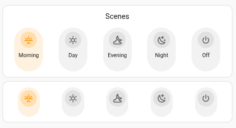
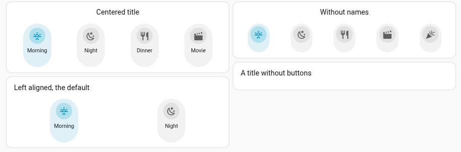
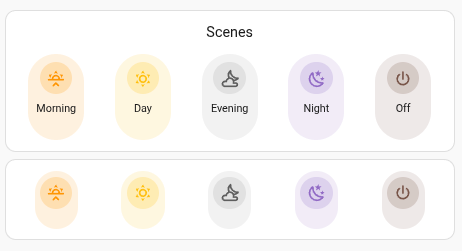
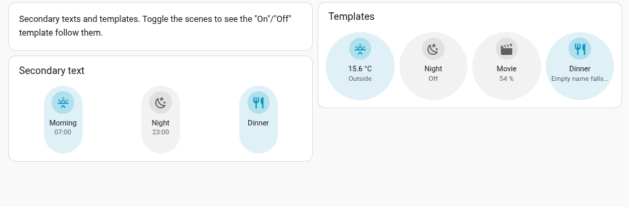

# HA Scene Card

[](https://github.com/I-Simen-I/ha-scene-card/releases/latest)
[](https://github.com/I-Simen-I/ha-scene-card/commits/main)
[](#marketplace-recommended)

A beautiful and simple way to show which scenes are active on your [Home Assistant](https://www.home-assistant.io/) dashboards: a row of buttons, with the active scene in color. It works just as well for other things that turn on and off, like switches, lights and helpers.



See the [examples](#examples) below for how to set up your scenes.

## Features

- **Any number of buttons** in a row, like a horizontal stack
- **Shows the active scene** in color, the rest in grey
- **Your own name, icon and color** per button, or the entity's name and icon and your theme's primary color
- **Secondary text and templates**, like a sensor value under the name
- **Toggles on tap**, or any action Home Assistant supports on tap, hold and double tap
- **Visual editor** in your Home Assistant language
- **Sections and masonry dashboards**, keyboard support and styling with card-mod

## Installation

Requires Home Assistant 2026.4 or newer.

### Marketplace (recommended)

From Home Assistant 2026.11, HACS is built in as the **Marketplace** (Settings → Marketplace). On older versions, use [HACS](https://hacs.xyz/); the steps are the same.

[](https://my.home-assistant.io/redirect/hacs_repository/?owner=I-Simen-I&repository=ha-scene-card&category=plugin)

1. Click the button above, or add `https://github.com/I-Simen-I/ha-scene-card` as a custom repository of type **Dashboard**. In the Marketplace, adding custom repositories needs a connection to GitHub.
2. Download **HA Scene Card**.
3. Reload your browser.

### Manual

1. Download `ha-scene-card.js` from the [latest release](https://github.com/I-Simen-I/ha-scene-card/releases/latest) and copy it to your `config/www` folder. If the folder doesn't exist, create it and restart Home Assistant, which only serves `/local/` from a folder that existed when it started.
2. Go to **Settings → Dashboards → ⋮ → Resources** and add `/local/ha-scene-card.js` as a **JavaScript module**.
3. Reload your browser.

## Configuration

### Visual editor

Add the card from the card picker. Add buttons with the entity picker below them, drag them by the handle to change the order, and open a button to change its name, secondary text, icon, color and actions.

### YAML

```yaml
type: custom:ha-scene-card
buttons:
  - entity: input_boolean.morning_scene
    name: Morning
    icon: mdi:weather-sunset-up
    color: orange
  - entity: input_boolean.night_scene
  - input_boolean.movie_scene # short for { entity: ... }
```

#### Card options

| Name           | Type    | Default   | Description                                                            |
| -------------- | ------- | --------- | ---------------------------------------------------------------------- |
| `buttons`      | list    | `[]`      | The buttons, see below. Without buttons or a title the card is hidden. |
| `title`        | string  | none      | Title above the buttons.                                               |
| `center_title` | boolean | `false`   | Center the title instead of aligning it left.                          |
| `show_name`    | boolean | `true`    | Show the names under the icons. Without them the buttons are narrower. |
| `color`        | string  | `primary` | Color of active buttons, unless a button sets its own.                 |

Titles, left aligned or centered, and buttons without names, in the theme's primary color:



#### Button options

| Name                | Type   | Default            | Description                                                         |
| ------------------- | ------ | ------------------ | ------------------------------------------------------------------- |
| `entity`            | string | **required**       | The entity. The button is active while it is `on`.                  |
| `name`              | string | The entity's name  | Name under the icon. Can be a [template](#templates).               |
| `secondary`         | string | none               | Smaller text under the name. Can be a [template](#templates).       |
| `icon`              | string | The entity's icon  | Any icon, like `mdi:movie-open`.                                    |
| `color`             | string | The card's `color` | Color when active.                                                  |
| `tap_action`        | object | `action: toggle`   | [Action](https://www.home-assistant.io/dashboards/actions/) on tap. |
| `hold_action`       | object | none               | Action on hold.                                                     |
| `double_tap_action` | object | none               | Action on double tap.                                               |

Colors are a name from Home Assistant's color picker (`primary`, `accent`, `red`, `orange`, `green`, `indigo`, ...), which follow your theme, or any CSS color like `#ff9800` or `var(--my-color)`.



Entities that don't exist are shown greyed out with a question mark, and entities that are `unavailable` or `unknown` are greyed out.

## Examples

### Setting up scenes

Scenes in Home Assistant have no state, so the card can't tell which one is active. This recipe gives each scene a switch that is on while its scene is active. Here for the scenes Day, Night and Morning; the YAML goes in `configuration.yaml`, and each step can also be done in the UI.

**1. A toggle helper per scene** (**Settings → Devices & services → Helpers → Toggle**), which remembers which scene is active:

```yaml
input_boolean:
  scene_day:
    name: Day
  scene_night:
    name: Night
  scene_morning:
    name: Morning
```

**2. A scene per state of the house** (**Settings → Automations & scenes → Scenes**). Besides the lights and other entities, each scene turns its own helper on and the others off:

```yaml
scene:
  - name: House day
    entities:
      light.living_room: "on"
      light.bedroom: "off"
      input_boolean.scene_day: "on"
      input_boolean.scene_night: "off"
      input_boolean.scene_morning: "off"
```

**3. A template switch per scene** (**Helpers → Create helper → Template → Switch**). It's on while its helper is on, and turning it on activates the scene. It has no `turn_off`, so tapping the active scene again leaves it on:

```yaml
template:
  - switch:
      - name: House scene day
        unique_id: house_scene_day
        state: "{{ is_state('input_boolean.scene_day', 'on') }}"
        turn_on:
          - action: scene.turn_on
            target:
              entity_id: scene.house_day
```

**4. The switches as buttons** in the card. A tap toggles the switch, which activates the scene:

```yaml
type: custom:ha-scene-card
title: Scenes
center_title: true
buttons:
  - entity: switch.house_scene_day
    name: Day
    icon: mdi:weather-sunny
  - entity: switch.house_scene_night
    name: Night
    icon: mdi:weather-night
  - entity: switch.house_scene_morning
    name: Morning
    icon: mdi:weather-sunset-up
```

Since the state comes from the helpers, the active button also follows when a scene is activated some other way, like by an automation or a voice assistant.

**Shorter, without template switches:** skip step 3 and use the helpers as buttons, with a tap that activates the scene instead of toggling the helper. Tapping the active scene activates it again.

```yaml
type: custom:ha-scene-card
title: Scenes
center_title: true
buttons:
  - entity: input_boolean.scene_day
    icon: mdi:weather-sunny
    tap_action:
      action: perform-action
      perform_action: scene.turn_on
      target:
        entity_id: scene.house_day
  - entity: input_boolean.scene_night
    icon: mdi:weather-night
    tap_action:
      action: perform-action
      perform_action: scene.turn_on
      target:
        entity_id: scene.house_night
```

The switches are worth it when the scenes are also turned on from other places that toggle entities, like a dashboard tile or a voice command to "turn on Day".

### Templates

`name` and `secondary` can be [templates](https://www.home-assistant.io/docs/configuration/templating/), rendered by Home Assistant and updated when the entities they use change. `entity` is the button's entity.

```yaml
type: custom:ha-scene-card
buttons:
  - entity: input_boolean.dinner_scene
    secondary: "{{ states('sensor.dining_room_temperature') }} °C"
  - entity: input_boolean.movie_scene
    secondary: "{{ 'On' if is_state(entity, 'on') else 'Off' }}"
```



Plain text is shown as it is. An empty result shows the entity's name instead of an empty `name`.

### Actions

Run a script instead of toggling, and open more info on hold:

```yaml
type: custom:ha-scene-card
buttons:
  - entity: input_boolean.dinner_scene
    tap_action:
      action: perform-action
      perform_action: script.dinner
    hold_action:
      action: more-info
```

## Troubleshooting

- **"Custom element doesn't exist: ha-scene-card"**: the card isn't loaded. Check that it's installed in the Marketplace (or HACS), or added as a resource if you installed it manually, then reload your browser.
- **Changes don't show after an update**: your browser is using a cached copy. Reload without cache (Ctrl+Shift+R or Cmd+Shift+R), or clear the cache in the Home Assistant app.
- **A button never turns active**: the button follows its entity's state, and only `on` counts as active. Scenes (`scene.*`) have no on state; use a switch as in [Setting up scenes](#setting-up-scenes).

Still stuck? [Open an issue](https://github.com/I-Simen-I/ha-scene-card/issues).

## Development

Requires Node 24 or newer and Yarn 4 via Corepack. Node 25 and newer no longer include Corepack, so install it separately (for example `brew install corepack` or `npm install -g corepack`) and run `corepack enable`.

```bash
yarn install     # install dependencies
yarn build       # build dist/ha-scene-card.js
yarn watch       # rebuild on changes
yarn typecheck   # TypeScript
yarn lint        # ESLint and Prettier
yarn test        # smoke tests of the built card
yarn ha:up       # local Home Assistant with test scenes on http://localhost:8125 (needs Docker and a build)
```

The local test environment and the release process are described in [`dev/README.md`](dev/README.md).

Built with TypeScript, Lit 3 and webpack.

## More cards

- [Simple Weather Card](https://github.com/I-Simen-I/simple-weather-card): a minimalistic weather card with a forecast, day and night icons and a visual editor.
- [Stack In Card](https://github.com/I-Simen-I/stack-in-card): group several cards into one card, without the borders, shadows and gaps between them. Stack them vertically or horizontally, nested stacks included.

## License

[MIT](LICENSE)
